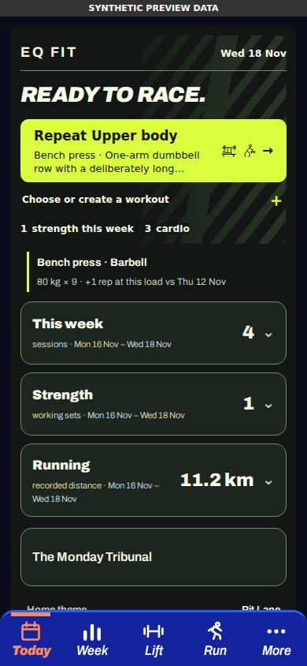
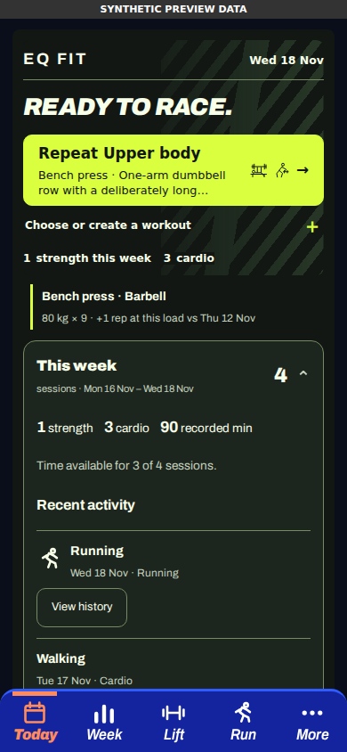
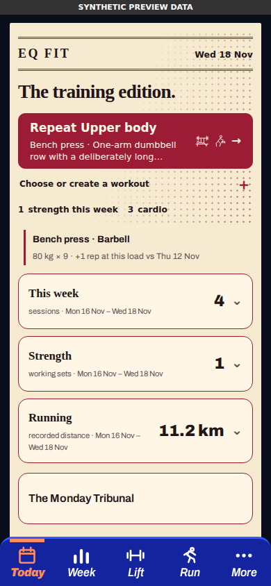
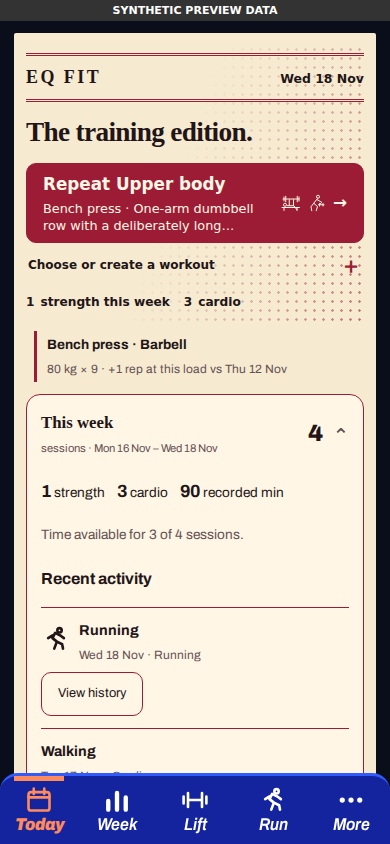
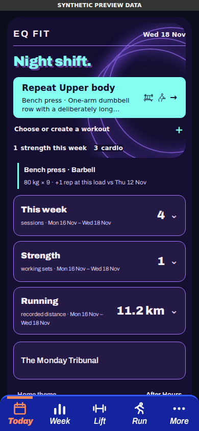
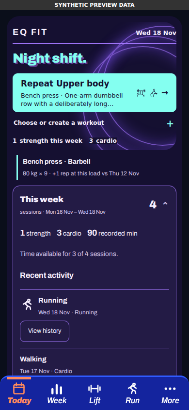

# EQ Fit Home previews

All screenshots use labelled synthetic training records. Browser viewport widths
are 390 and 320 px, both 844 px high. These are captures of the actual app.

| Theme | Compact | This week expanded |
|---|---|---|
| Pit Lane |  |  |
| Front Page |  |  |
| After Hours |  |  |

## Additional checks

| Theme | 320 px compact | 320 px expanded | Strength / Max day | Form and save error |
|---|---|---|---|---|
| Pit Lane | [View](pit-lane-320-compact.png) | [View](pit-lane-320-expanded.png) | [View](pit-lane-390-strength.png) | [View](pit-lane-320-form-error.png) |
| Front Page | [View](front-page-320-compact.png) | [View](front-page-320-expanded.png) | [View](front-page-390-strength.png) | [View](front-page-320-form-error.png) |
| After Hours | [View](after-hours-320-compact.png) | [View](after-hours-320-expanded.png) | [View](after-hours-390-strength.png) | [View](after-hours-320-form-error.png) |

The automated browser check covers one expanded main card, header visibility when
switching cards, history links, theme changes, repeat/log/pause/continue/finish,
disabled save controls, recovery after a simulated save failure, and a verified
Max day PR flag that does not replay on reload.

Real iPhone keyboards, native sharing and installed/offline PWA behaviour need a
device trial. Chrome was run with reduced motion for deterministic captures.
