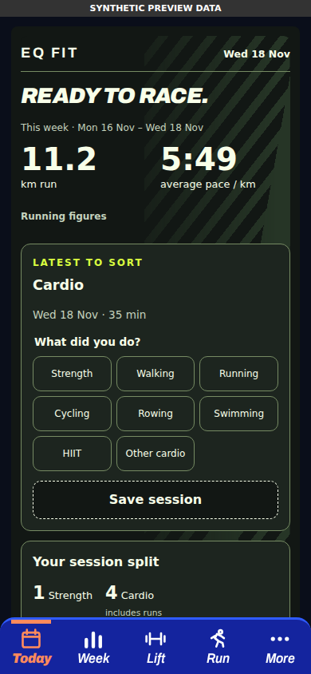
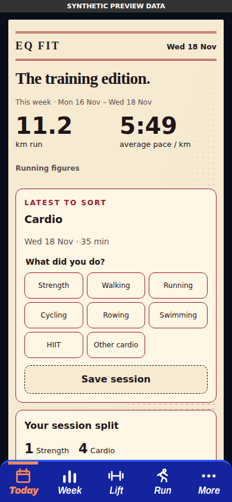
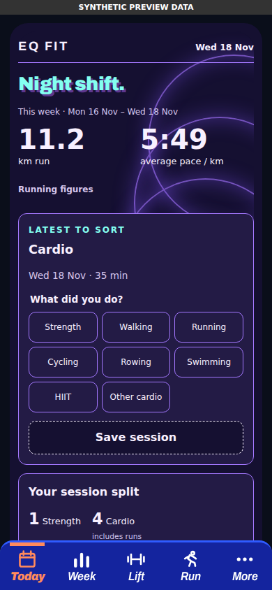
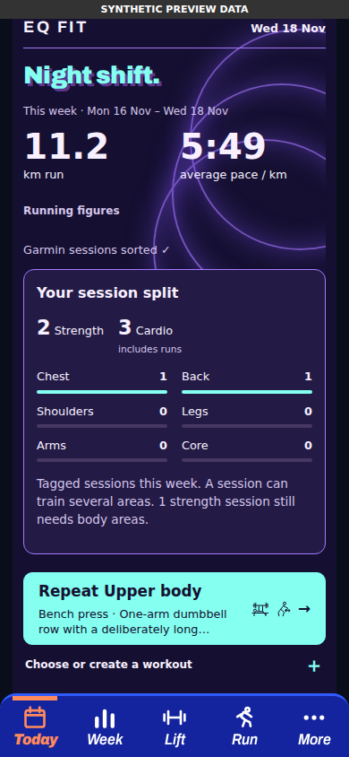

# Garmin dashboard previews

All figures below are synthetic. The screenshots use the actual app at 390×844
and 320×844. Both kilometres and weighted average pace cover the same week.

| Pit Lane | Front Page | After Hours |
|---|---|---|
|  |  |  |
| [320 px](dashboard-pit-lane-320.png) | [320 px](dashboard-front-page-320.png) | [320 px](dashboard-after-hours-320.png) |

## After saving the session

The sample Garmin Cardio session was labelled Strength with Chest and Back.
It then appears in the weekly strength count and once in each tagged body area.

[320 px updated split](session-sorted-320.png)

The browser checks also cover the progress/history drawers, theme changes,
repeat/log/pause/continue/finish, save errors, disabled controls and record flags.
Real iPhone keyboards, Safari, native sharing and installed/offline PWA behaviour
still need a device trial.
