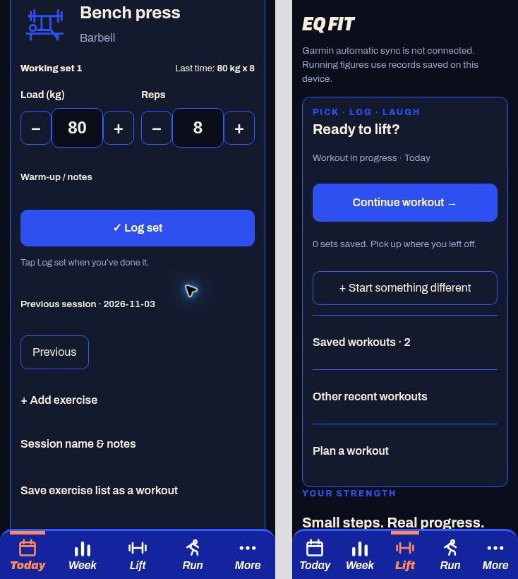
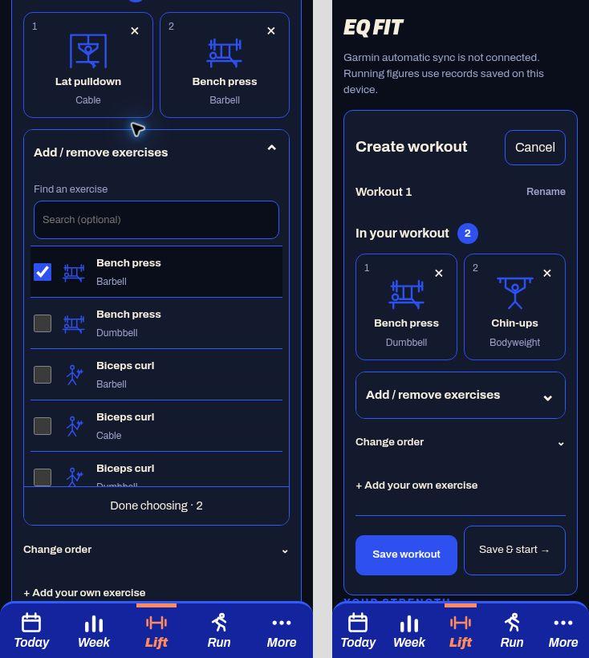

# Saved workouts: pick, log, laugh

Users can create and edit named routines from Today or Lift, choose existing exercises or create their own, and reorder or remove exercises from the routine. A routine is only an exercise list. Starting it creates a fresh planned weights session with no completed sets, notes or watch link. Users can also save an existing session’s exercise list as a new routine. Editing a routine does not alter sessions already created from it.

The session editor shows one exercise at a time, with previous recorded values, a compact saved-set table, weight/reps entry and an explicit Log completed set button. Saved checkmarks open set editing; removal is inside that edit view. Advanced details remain available, including warm-ups, RIR, pain notes, history and equipment-aware labels. Adding an exercise stays available during training. Unsaved values are suggestions, never completed work. The existing main-lift quick log and Repeat session still work.

Finishing saves the session before showing working-set/exercise totals and the existing optional Coach EQ. Coach uses the current tone, consent, repetition and evidence rules, scoped to the current profile. It is absent from the active logging view. Share the sledge shares only the joke and attribution via the device share sheet (or copies it when sharing is unavailable); nothing is sent automatically. Humour off keeps logging usable.

Storage is local. IndexedDB v4 adds a routines table without changing existing records. Backup v4 includes routines and validates their exercise references; backups v1–v3 migrate with an empty routines table. A v4 backup requires this version of the app or newer. Restore remains atomic, and owner/friend databases remain separate. Garmin importing is unchanged; strength import expansion is separate work.

Validation: 404 JavaScript tests passed; 12 tests requiring unavailable private CSV fixtures skipped. All 16 Python tests and the production build passed. Added tests cover plan-only completion, repeat suggestions, routine edits preserving existing sessions, invalid references, backup round-trip, profile isolation and upgrade from a real v3 IndexedDB schema. Browser QA with synthetic data covered custom routine/exercise creation, 80 kg × 8 / 8 / 10, a second exercise, finishing with four working sets across two exercises, and optional session banter. Set logging layouts inspected at 390px and 320px. Real-device keyboard, native share sheet and installed/offline PWA checks remain device-specific.

## Picture picker update

Routine setup and in-session Add exercise now offer 12 movement illustrations with short labels. Equipment variants use picture buttons; exact existing name/equipment identities are reused without overwriting user metadata. Existing exercises are shown first, newest-created first (not a fabricated usage ranking). Custom exercises remain under Add something else. New routines receive the first unused Workout N name; renaming is optional and no text field is auto-focused. Saved-set identity, backup format and Coach behaviour are unchanged.

Logging now reuses the large minus/plus number controls. New exercises suggest eight reps; missing weight remains blank with optional 20/40/60/80 kg shortcuts. Values remain editable suggestions until Log completed set is pressed; no set is logged merely by choosing a picture or adjusting a number. Unrecognised custom movements use a generic weights icon rather than an incorrect deadlift illustration.

Validation: 408 JavaScript tests passed, 12 unavailable private-fixture tests skipped; production build passed. Browser test created Workout 1 with dumbbell shoulder press and cable lat pulldown, saved it, logged 22.5 kg × 9 using taps only and reached the finish/Coach screen. Picture layouts inspected at 390px and 320px. Actual mobile keyboard/native sharing/offline checks remain device-specific.

## Everyday workout flow — November 2026

Today and Lift now share one entry point: continue the newest unfinished workout,
repeat the latest completed workout, or start something different. Saved routines
and other recent sessions remain available behind short disclosures. A completed
session with actual sets is repeatable without naming it or saving a template.
Future plans are not offered early. Older unfinished sessions retain their original
date; stale empty drafts from previous days are not promoted.

During training, picture tabs switch exercises without implying that an exercise is
complete. The next set appears before saved-set history. Load and reps sit side by
side, advanced notes are collapsed, and Log set is the explicit completion action.
Undo removes the last set of the current exercise; saved rows remain editable.
Reopening restores the exercise of the last saved set. Suggestions follow the next
previous set, then this session's latest values, keeping warm-ups separate. The
exercise picker closes after a successful addition and focus moves to the exercise.

Pause preserves logged sets; unlogged input is not a completed set or durable draft.
No database/backup format changes. No timed holds, prescribed target sets, PDF
imports, new exercise catalogue expansion, or Garmin strength imports in this change.

Validation: automated workout-choice/suggestion tests plus the existing suite;
manual browser checks at 390px and 320px for repeat (zero copied sets), adjustment,
log, undo, correction, pause/reload/resume, adding a movement mid-session and finish.
Native phone keyboards, device offline/relaunch behaviour and actual user usability
still need a real-device trial.

## Checkbox builder — 4 November 2026

Creation now has a visible entry point on Lift and Today, rather than a nested
"Plan a workout" menu. The reusable-workout flow is:

1. Create workout. A default name is provided; renaming is optional.
2. Tick exercises in a single expandable, scrollable checklist. Exercise and
   equipment are labelled together. The complete built-in list is available even
   when the user has never saved an exercise; exact existing identities are reused.
3. Selected picture tiles show what is in the workout. Remove a tile or untick its
   row to remove it; Change order exposes optional up/down controls. Done choosing
   collapses the list to review the tiles. Custom exercises remain an optional path.
4. Save workout for later, or Save & start to save it and open an empty planned
   session. Only Log set records completed work during training.

Selection is entirely draft state: cancelling, ticking/unticking and custom draft
creation do not write exercises or routines. Saving resolves choices and persists
the routine (and optional session) in one transaction, rolling back on failure.
Editing a routine does not modify an already-started session. Completely empty
sessions no longer displace useful Continue choices. Quick session remains a
separate entry point for logging without a saved plan. Lifting history now uses
the same movement illustrations as selection, including push-ups.

Validation: 419 automated tests passed (12 private-fixture tests skipped), including
identity deduplication, equipment separation, ordered save, empty planned starts,
rollback and isolation of existing sessions. Mobile browser checks at 390/320px
covered multi-selection, tile removal, unticking, ordering, save/reopen, custom
selection cancellation and Save & start. Native iOS usability still needs a trial.

